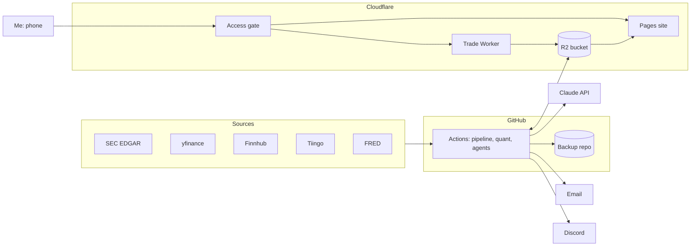

# Architecture

Two places, no servers.

- **GitHub:** code, plus scheduled jobs on GitHub Actions that do all fetching, math, and AI calls.
- **Cloudflare:** R2 storage, a static site on Pages, one small Worker for saving trades, and Access as the login gate.



## One writer

Only the pipeline ever writes the database. The site reads prepared files, and the Worker drops each new trade into an inbox folder as its own file. The next pipeline run picks up inbox files and adds them to SQLite. Two writers can never collide.

## Jobs

All times Central. GitHub cron runs in UTC and can start late under load, so schedules use odd minutes and every job is safe to rerun.

**Changed 2026-10-30:** GitHub dropped or delayed most scheduled runs (docs/M7.md), so a Cloudflare Worker cron (`worker/src/scheduler.ts`) starts the same jobs at the same times through GitHub's API. It holds one narrow token (start runs on this repo, nothing else).

| Job | When | Does |
|---|---|---|
| Nightly | About 9:17 pm (10:17 pm in summer), every trading day. Was 7:17 pm until 2026-11-05: Yahoo leaves the day's close blank until about 9:20 pm New York time | Market calendar check, fetch prices and fundamentals, quality checks, scores, verdicts, screen files, inbox, backups, daily summary |
| Holdings watch | Hourly, about 8 am to 6 pm, weekdays | New 8-Ks, headlines, live quotes for holdings; urgent alerts; inbox |
| Weekly | Weekend | Agent panel batch on shortlist and holdings, weekly report |
| Monthly | First weekend | Universe rebuild, monthly report, restore test, reconciliation reminder |
| Backfill | Manual | One-time history load, checkpointed |

Alerts produced during quiet hours (9 pm to 7 am) are held and sent at 7 am.

## Storage layout (R2)

```
raw/<source>/<yyyy-mm-dd>/...        untouched API responses
market/prices/year=YYYY/*.parquet    raw daily OHLCV, keyed by CIK + date
market/fundamentals/*.parquet        point-in-time facts with filed date
market/corporate_actions.parquet     splits, dividends
market/universe/YYYY-MM.parquet      monthly universe snapshots
market/membership.parquet            S&P 500 membership spells
market/ticker_map.parquet            ticker -> CIK with date ranges
db/app.sqlite                        irreplaceable records
backups/daily/YYYY-MM-DD.sqlite      30 kept
backups/monthly/YYYY-MM.sqlite       kept indefinitely
inbox/<timestamp>-<id>.json          trades from the Worker, pending
site/*.json                          prepared screen data
logs/runs/<run-id>.json              run health, failures, costs
```

## Irreplaceable records (SQLite)

Every table is append-only. Triggers reject UPDATE and DELETE. A correction is a new row pointing at the row it fixes.

| Table | Holds |
|---|---|
| trades | buys, sells, deposits, withdrawals, per lot |
| corrections | fixes to earlier rows, with reason |
| verdicts | every verdict with score, signal ranks, gates passed, timestamp, previous-row hash |
| buy_snapshots | frozen "why I bought" per lot |
| panel_opinions | agent panel verdicts with cited quotes |
| alerts | what was sent, when, on which channel |
| experiments | every backtest variation tried, with result |

Current holdings are derived from trades and corrections, never stored as editable state.

## Data contract

The site only reads files in `site/`. Their shape is defined once as JSON Schema in `contract/`. Python validates every file against it before upload, and TypeScript types for the site are generated from the same schema. A malformed file fails the run loudly instead of reaching the screen.

Files: `today.json`, `picks.json`, `holdings.json`, `holding/<cik>.json`, `reports/weekly.json`, `reports/monthly.json`, `settings.json`, `health.json`.

## Agent flow

1. Code gathers documents for a stock (filings sections, articles), cleans them to visible text, scans for instruction-like content (quarantined), and tags each with an ID, date, and trust tier.
2. Each panel agent gets only those documents plus numbers from our database, never the math score.
3. Agents return a fixed schema: verdict, confidence, claims, and for each claim an exact quote and document ID.
4. Code checks every quote appears in its document and every number matches the database or a quote. Failures are removed and counted.
5. The judge combines the panel into one view. Occasionally it reruns on identical input; a flip marks the view low confidence.
6. Results go to `panel_opinions` and the screen files.

Agents have no tools, no network, and no write access.

## Security

- Cloudflare Access in front of the site, data files, and the trade Worker. One-time code to my email only.
- R2 bucket has no public access.
- Secrets (R2 keys, Claude API key, Finnhub key, Discord webhook, email app password) live in GitHub secrets and Cloudflare's secret store, never in code or logs.
- No third-party analytics on the site.

## Repo layout

```
pipeline/     fetchers, quality checks, storage writers
quant/        signals, scoring, verdicts, sizing, risk, backtest
agents/       document prep, prompts, verification, panel
monitor/      alert rules, delivery, reconciliation
contract/     JSON Schema for site files
site/         React + Vite + TypeScript app
worker/       Cloudflare Worker for the trade inbox
.github/      scheduled workflows
tests/        including the point-in-time test and agent test set
```
